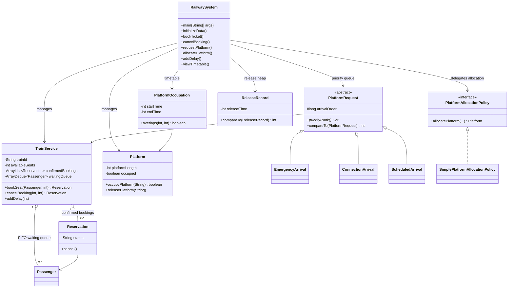

# Railway Reservation and Platform Allocation System

## 1. Problem analysis

Payanam Junction is represented as one station with six train services, three platforms, and one end-to-end General seat class of ten seats per train. The program models bookings and platform reservations in memory for one run. It is a teaching simulation, not a live railway system.

The program addresses two station tasks:

1. **Reservations:** confirm a booking while seats remain. When full, append the passenger to that train's FIFO waiting list. A cancellation frees a seat and promotes the oldest waiting passenger immediately.
2. **Platform scheduling:** order requests by emergency, connection, then scheduled type; break category ties by declared train priority and then request arrival order. Assign the first numbered platform that is long enough and has no overlapping reserved interval. An interval runs from arrival through departure plus a ten-minute clearance buffer. An occupying train is not displaced.

Time values are integer minutes on a single simulated day. The sample values are relative minutes, not clock strings. The scope excludes multiple stations, route planning, payment, live feeds, authentication, and persistence from the original console model. The optional web demo separately demonstrates SQLite-backed booking data.

## 2. Data structures and algorithm choices

| Structure | Used for | Why it fits |
|---|---|---|
| `HashMap` | Train, passenger, reservation, and platform lookup | Finds an item by its ID without scanning every item. |
| `ArrayDeque` | Each train's waiting passengers | `addLast` and `removeFirst` express FIFO order directly. |
| `PriorityQueue<PlatformRequest>` | Waiting train requests | Selects the highest-ranked request; `compareTo` gives deterministic ties. |
| `PriorityQueue<ReleaseRecord>` | Future platform release events | A min-heap exposes the earliest release time first. |
| `ArrayList<PlatformOccupation>` | Platform timetable | Keeps reservations that can be scanned for conflicts and displayed in start-time order. |
| Linear platform scan | Candidate platform selection | Three platforms are small enough to check in order; check length first, then every interval on that platform. |

For intervals `[a,b)` and `[c,d)`, overlap is `a < d && b > c`. The half-open interval means one occupation ending exactly when another begins is not an overlap. Allocation checks the proposed interval `[arrival, departure + 10)`.

## 3. UML class diagram



## 4. Scenario checks and results

The checks were run against the source classes using JDK 21.

| Scenario | Setup | Expected and observed result |
|---|---|---|
| 30 booking requests | See `sample-booking-requests.csv`; five requests per each of six services | Dataset contains 30 distinct sample requests. The console menu records one request at a time; it does not import CSV files. |
| Cancelled seat and FIFO promotion | Fill T101's ten seats, add two waiting passengers, cancel reservation 1 | **PASS.** Eleventh passenger is queued. Cancellation promotes that oldest passenger and the seat count returns to zero available. |
| Overlapping arrivals | All three platforms have reservations covering the proposed train's interval | **PASS.** Allocation returns no platform. |
| Overlong train | Request a 351-unit train when the longest platform is 350 units | **PASS.** Allocation returns no platform. |
| Delay extends platform occupation | Delay a reserved train by 20 minutes | **PASS.** Arrival and departure each move 20 minutes; the timetable occupation and release time move with them, preserving the 10-minute clearance. |
| Java compile | Compile all project Java sources and scenario checks | **PASS.** `javac -d target\\check *.java` completed successfully. |
| Browser JavaScript syntax | Check the dashboard script | Previously checked with `node --check`; this only checks syntax, not browser interactions. |

To rerun the Java scenario checks from the project folder:

```powershell
javac -d target\check *.java
java -cp target\check AssignmentScenarioChecks
```

Expected final line: `All assignment scenario checks passed.` The helper is an educational, dependency-free check, not a JUnit suite. The overlap and overlong cases call the same allocation policy used by the app, with explicit sample inputs. The delay check calls the actual `RailwaySystem.addDelay()` method.

## 5. Demonstration flow

1. Start the console program with `java RailwaySystem` and show six services and three platforms.
2. Book one passenger and show the confirmed reservation.
3. In the separate scenario checker, demonstrate ten confirmed seats, a waiting passenger, cancellation, and FIFO promotion.
4. Run the allocation checks to show an overlapping timetable and an overlong train receive no platform.
5. Show a successful delay shifting the occupation end; explain the clearance buffer.
6. If demonstrating the web enhancement, start it with `run-web.bat`, book/cancel in the browser, and show that SQLite stores the web-demo bookings.

Screenshots to capture for the final report: console startup with six trains/three platforms; booking and waitlist promotion; timetable before/after a delay; rejected overlap/overlong checks; and the web dashboard with saved bookings. Add your own screenshots after running these steps; none are embedded here because they must show your actual run.

## 6. Limitations and future improvements

- The original console simulation keeps state in memory and resets when it exits.
- The console menu does not import the 30-row CSV; requests are entered individually.
- The web demo persists passenger and reservation data in SQLite, but it does not implement platform allocation, live train operations, or user accounts.
- The model uses one station, synthetic data, one seat class, and a simple first-fit platform policy.
- A production system would need stronger validation, concurrency control, audit history, security, and integration with trusted railway data.

Possible future work: connect the web interface to the full platform scheduler; add CSV import/export; support multiple seat classes and stations; and store timetable/platform events in the database.

## 7. SDG connection

The project is an educational simulation of transport infrastructure planning (SDG 9) and station resource use for communities (SDG 11). It does not measure real-world sustainability outcomes.
